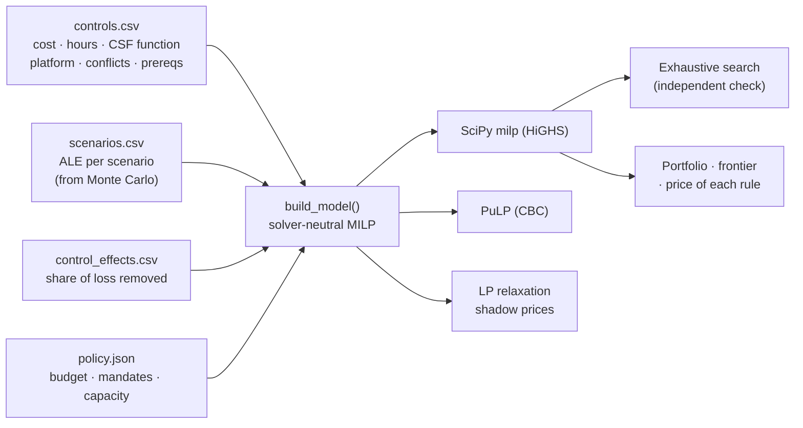

# Security Budget Optimizer

**A mixed-integer program that picks the set of security controls that removes the most expected cyber loss for a given budget.** It honors compliance mandates, NIST CSF coverage, product conflicts, prerequisites, platform fees and analyst capacity.


%20%7C%20CBC%20(PuLP)-informational)


> **Origin:** built on optimization methods from my graduate work in **Simulation & Optimization** at Texas Tech University (2022): a constrained binary-selection case study plus a modeling study on fixed charges, big-M either/or constraints, and slack/shadow-price sensitivity. The original case selected artwork for an exhibition; this repository applies the same modeling patterns to security spending. Scenario losses come from the companion [**cyber-risk-monte-carlo**](https://github.com/casildata/cyber-risk-monte-carlo) project.

---

## TL;DR

| Question | Answer (illustrative inputs) |
|---|---|
| What should a **$600k** budget buy? | 10 controls, including EDR (via an XDR suite), immutable backups, phishing-resistant MFA, email security, DLP and database encryption. They remove **$760k (63%)** of the $1.20M annual loss expectancy, for a **ROSI of +27%** |
| Where does extra spending stop paying for itself? | Net benefit peaks at **$410k**. Risk removed falls below spend between **$825k and $850k**; beyond that, more budget is a risk-appetite decision, not an ROI one |
| What do the policy rules cost? | The MFA mandate costs nothing (the optimizer funds MFA anyway). Requiring CSF coverage costs **$76k** of risk reduction at a $300k budget and **$0** from $600k up |
| Is the answer actually optimal? | Yes. At every budget tested, the MILP matches an **exhaustive search of all 262,144 control combinations** |


---

## Approach



**Objective.** Choose binary $`x_c`$ (fund control $`c`$) to maximize risk reduction, where controls overlap **multiplicatively**: each one removes a share $`e_{c,s}`$ of the loss that is still left in scenario $`s`$.

$$
\max_{x} \; \sum_{s} \left( \mathrm{ALE}_s - r_s \right),
\qquad
r_s = \mathrm{ALE}_s \prod_{c} \left( 1 - e_{c,s}\, x_c \right)
$$

A product of binaries isn't linear. The model builds it as a chain over the controls $`c_1, c_2, \dots`$ that affect scenario $`s`$, starting from $`w_{s,0} = \mathrm{ALE}_s`$ and ending at $`r_s = w_{s,K}`$:

$$
w_{s,k} = w_{s,k-1} - e_{c_k,s}\, u_{s,k},
\qquad
u_{s,k} = w_{s,k-1}\, x_{c_k}
$$

Each product $`u_{s,k}`$ of a bounded continuous variable and a binary is linearized **exactly** with four McCormick (big-M) inequalities, with $`M = \mathrm{ALE}_s`$:

$$
u_{s,k} \le M x_{c_k}, \qquad
u_{s,k} \le w_{s,k-1}, \qquad
u_{s,k} \ge w_{s,k-1} - M \left( 1 - x_{c_k} \right), \qquad
u_{s,k} \ge 0
$$

An earlier additive version with a cap kept picking many cheap minor controls instead of EDR and backups; the multiplicative form fixed that.

The business rules use platform-fee binaries $`y_p`$, an MSSP binary $`z`$, annual costs $`\mathrm{cost}_c`$, fees $`F`$ and analyst hours $`h_c`$:

| Business rule | Constraint | Pattern from the original study |
|---|---|---|
| Stay within budget, counting platform and MSSP fees | $`\sum_c \mathrm{cost}_c\, x_c + \sum_p F_p y_p + F_{\mathrm{MSSP}}\, z \le B`$ | Knapsack budget |
| Cyber-insurance requires phishing-resistant MFA | $`x_{\mathrm{MFA}} = 1`$ | "Display all of an artist's works" |
| At most one EDR product | $`x_{\mathrm{EDR\_A}} + x_{\mathrm{EDR\_B}} \le 1`$ | "Only one collage" |
| SOAR and UEBA need a SIEM | $`x_{\mathrm{SOAR}} \le x_{\mathrm{SIEM}}, \; x_{\mathrm{UEBA}} \le x_{\mathrm{SIEM}}`$ | "If piece A, then piece B" |
| At least 1 control per NIST CSF function | $`\sum_{c \in f} x_c \ge 1 \;\; \text{for each function } f`$ | "At least one of each style" |
| Protect at most 2 × (Detect + Respond + Recover) | $`\sum_{c \in \mathrm{PR}} x_c \le 2 \sum_{c \in \mathrm{DE} \cup \mathrm{RS} \cup \mathrm{RC}} x_c`$ | "Paintings ≤ 2 × other forms" |
| XDR-suite modules need the suite licence | $`x_c \le y_{\mathrm{suite}}`$ for each suite module $`c`$ | Fixed charge (set-up cost) |
| Analyst hours: in-house capacity **or** MSSP capacity | $`\sum_c h_c x_c \le H_{\mathrm{in}} + M z`$ and $`\sum_c h_c x_c \le H_{\mathrm{MSSP}} + M (1 - z)`$ | Either/or plant constraint |

Two objectives fill out the analysis: `max_net_benefit` (reduction − spend) and `min_cost` (cheapest portfolio that reaches a target). Ties are broken lexicographically: maximize risk reduction, then minimize spend at that level.

## Results

Full tables: [`docs/results.md`](docs/results.md).

### Recommended portfolio at $600k

| Scenario | ALE before | ALE after | Removed |
|---|---|---|---|
| Ransomware | $337,719 | $86,373 | 74% |
| Business email compromise | $239,333 | $70,005 | 71% |
| Customer data breach | $380,614 | $153,086 | 60% |
| DDoS outage | $132,075 | $50,188 | 62% |
| Insider misuse | $114,455 | $84,239 | 26% |

Spend $600,000 (including the $40k XDR suite fee) · 1,850 of 2,000 in-house analyst hours · no MSSP needed.

### Price of each policy rule

| Rule removed | at $300k | at $400k | at $600k | at $1M |
|---|---|---|---|---|
| Mandatory MFA | $0 | $0 | $0 | $0 |
| ≥ 1 control per CSF function | +$76,424 | +$16,728 | $0 | $0 |
| Protect ratio | $0 | $0 | $0 | $0 |
| MSSP option (taken away) | $0 | $0 | $0 | −$64,736 |

Coverage rules bind when money is tight: they force spending on Identify/Recover controls that a pure loss-minimizer would skip. Whether that's worth it is exactly the conversation to have with leadership.

### Portfolios are not nested


A bigger budget can *swap out* a control. The standalone EDR and the XDR-suite EDR trade places several times as the budget grows, depending on whether the suite fee can be shared with email security. Ranking controls by "bang for the buck" and buying down the list misses this; the integer program doesn't.

## Framework mapping

**NIST CSF 2.0.** Each control carries its CSF Function (Identify, Protect, Detect, Respond, Recover), and the coverage rule enforces at least one per Function. Govern isn't one of them because none of these controls is a governance control. The analysis itself supports these outcomes:

| Outcome | How this repository supports it |
|---|---|
| GV.RR-03: Adequate resources are allocated commensurate with the cybersecurity risk strategy, roles, responsibilities, and policies | Budget and analyst hours allocated against expected loss |
| ID.RA-06: Risk responses are chosen, prioritized, planned, tracked, and communicated | The optimizer chooses and prioritizes controls; the frontier communicates the trade-off |
| GV.RM-06: A standardized method for calculating, documenting, categorizing, and prioritizing cybersecurity risks is established and communicated | One rule, ALE × multiplicative effect, applied the same way to every control |
| GV.OC-03: Legal, regulatory, and contractual requirements regarding cybersecurity … are understood and managed | The cyber-insurance MFA requirement is a hard constraint, and its cost is reported ($0) |

**CIS Controls v8.1.** `data/controls.csv` has a `cis_safeguard` column, shown in the catalogue in [`docs/results.md`](docs/results.md):

| Control | CIS v8.1 safeguard |
|---|---|
| EDR (either product) | 10.1 Deploy and Maintain Anti-Malware Software; 10.7 Use Behavior-Based Anti-Malware Software; 13.7 Deploy a Host-Based Intrusion Prevention Solution |
| Immutable backups · DR testing | 11.4 Establish and Maintain an Isolated Instance of Recovery Data · 11.5 Test Data Recovery |
| Phishing-resistant MFA | 6.3 Require MFA for Externally-Exposed Applications; 6.5 Require MFA for Administrative Access |
| Email security | 9.7 Deploy and Maintain Email Server Anti-Malware Protections |
| DLP · database encryption | 3.13 Deploy a Data Loss Prevention Solution · 3.11 Encrypt Sensitive Data at Rest |
| SIEM | 8.11 Conduct Audit Log Reviews; 13.1 Centralize Security Event Alerting |
| Privileged access management | 5.4 Restrict Administrator Privileges to Dedicated Administrator Accounts |
| Vulnerability management · asset inventory | 7.1 Establish and Maintain a Vulnerability Management Process · 1.1 Establish and Maintain Detailed Enterprise Asset Inventory |
| IR retainer · tabletop exercises | 17.4 Establish and Maintain an Incident Response Process · 17.7 Conduct Routine Incident Response Exercises |

Payment call-back, DDoS scrubbing, SOAR and UEBA have no direct v8.1 safeguard; the column is left blank for them.

## Limitations & lessons learned

### Verification

| Check | How |
|---|---|
| Model encoding | `brute_force_max_reduction` enumerates all $`2^{18} = 262{,}144`$ control subsets with NumPy, applies every rule directly (not via the MILP matrices), and computes the exact product. It matches the MILP at every $25k step from $230k to $1.2M |
| Closed form | Reported risk reduction is recomputed from the chosen controls with $`\mathrm{ALE}_s \prod_c (1 - e_{c,s})`$ |
| Numerics | In raw dollars, HiGHS once reported a feasible $250k budget as infeasible (big-M coefficients near 380,000 next to effects of 0.03). Money is now modeled in $ thousands; a regression test covers it |
| Second solver | Same model through PuLP/CBC (`solve_pulp`): it matches HiGHS to the dollar at $300k, $600k and $1M. Needs PuLP 2.7–3.x; PuLP 4 changed its API, so the cross-check skips itself with a message there, as it does when PuLP is missing |

## Getting started

### Requirements

- Python 3.10 or later (tested on 3.14) with the packages in `requirements.txt` (NumPy, pandas, SciPy, matplotlib).
- Optional: PuLP 2.7–3.x for the second solver backend (`pip install "pulp>=2.7,<4"`), and pytest.
- No external data: the inputs are in `data/`.

### Install

```bash
pip install -r requirements.txt
```

`run_all.py` never installs anything. If a package is missing or too old, it stops and prints the `pip` command to run.

### Run

```bash
python run_all.py
python run_all.py --budget 750000    # another budget
python tests/test_optimizer.py       # or: pytest
```

Edit the CSVs and `policy.json` to model your own environment.

### Output

About 15 seconds. Writes `docs/results.md` and the figures in `docs/figures/`; the budget sweep goes to `outputs/budget_sweep.csv` (git-ignored). Solve timings go to the console only, so a rerun reproduces `docs/results.md` exactly; the committed copy was generated with PuLP 3.x installed, so without it only the cross-check line differs.

## Repository structure

```
security-budget-optimizer/
├── run_all.py                  # all tables and figures → docs/results.md
├── check_requirements.py       # stops with the pip command if a package is missing
├── requirements.txt
├── optimizer/
│   ├── data.py                 # load + validate inputs
│   ├── model.py                # solver-neutral MILP (McCormick chain, big-M, fixed charges)
│   ├── solvers.py              # SciPy/HiGHS, PuLP/CBC, LP relaxation duals
│   └── analysis.py             # business summary, tie-breaking, exhaustive search
├── data/                       # controls, scenarios, effects, policy (+ README)
├── tests/test_optimizer.py     # 10 tests; runs with or without pytest
└── docs/
    ├── results.md              # generated
    └── figures/                # generated
```

## Skills demonstrated

`Mixed-integer linear programming` · `exact linearization (McCormick envelopes, big-M disjunctions, fixed charges)` · `sensitivity analysis (slack, shadow prices, price of constraints, efficient frontier)` · `solver-neutral model design` · `verification by exhaustive enumeration` · `numerical debugging` · `translating security strategy into constraints` · `Python (NumPy, pandas, SciPy, matplotlib)`

## Roadmap

- Feed the Monte Carlo *distribution* of losses, not just the mean, and optimize a tail measure (e.g., the 1-in-20-year loss) with a scenario-based or CVaR formulation.
- Multi-year planning: one-time implementation costs, staged roll-outs and budget carry-over.
- Uncertainty in control effectiveness: robust optimization or a Monte Carlo sweep over the effects table.
- Small Streamlit front end for editing the catalogue and seeing the frontier update.

## Data & citations

All inputs in `data/` are illustrative; see [`data/README.md`](data/README.md). Scenario ALEs are the simulated means from the companion [**cyber-risk-monte-carlo**](https://github.com/casildata/cyber-risk-monte-carlo) project, [release v1.0](https://github.com/casildata/cyber-risk-monte-carlo/releases/tag/v1.0). That release also publishes the loss for every simulated year (`annual_loss_by_year.csv.gz`), the input for a future tail-risk (CVaR) version of this optimizer.

Framework references: NIST, [*The NIST Cybersecurity Framework (CSF) 2.0*](https://doi.org/10.6028/NIST.CSWP.29), CSWP 29, 2024; Center for Internet Security, [CIS Critical Security Controls v8.1](https://www.cisecurity.org/controls/v8-1).

## Author

Javier Casildo

## License

MIT. See [LICENSE](LICENSE).
