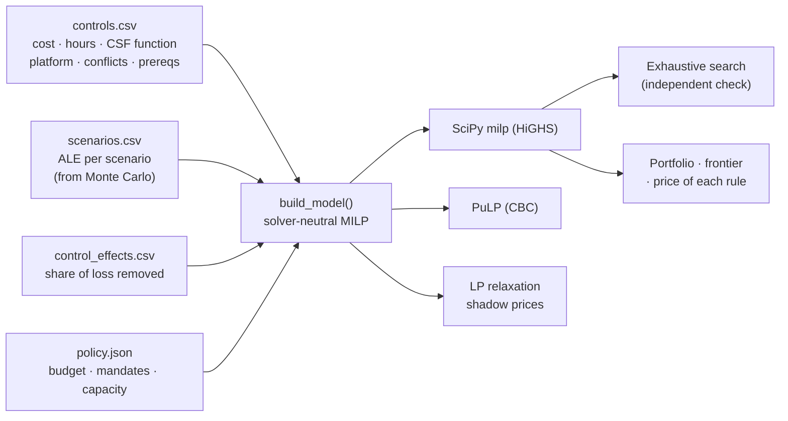

# Security Budget Optimizer

**A mixed-integer program that picks the set of security controls that removes the most expected cyber loss for a given budget.** It honors compliance mandates, NIST CSF coverage, product conflicts, prerequisites, platform fees and analyst capacity.


%20%7C%20CBC%20(PuLP)-informational)


> **Origin:** built on optimization methods from **ISQS 7339 Simulation & Optimization** at Texas Tech University (Spring 2022): a constrained binary-selection case study plus homework on fixed charges, big-M either/or constraints, and slack/shadow-price sensitivity. The coursework selected artwork for an exhibition; this repository applies the same modeling patterns to security spending. Scenario losses come from the companion [**cyber-risk-monte-carlo**](https://github.com/casildata/cyber-risk-monte-carlo) project.

---

## TL;DR

| Question | Answer (illustrative inputs) |
|---|---|
| What should a **$600k** budget buy? | 10 controls, including EDR (via an XDR suite), immutable backups, phishing-resistant MFA, email security, DLP and database encryption. They remove **$760k (63%)** of the $1.20M annual loss expectancy, for a **ROSI of +27%** |
| Where does extra spending stop paying for itself? | Net benefit peaks at **$410k**. Risk removed falls below spend between **$825k and $850k**; beyond that, more budget is a risk-appetite decision, not an ROI one |
| What do the policy rules cost? | The MFA mandate costs nothing (the optimizer funds MFA anyway). Requiring CSF coverage costs **$76k** of risk reduction at a $300k budget and **$0** from $600k up |
| Is the answer actually optimal? | Yes. At every budget tested, the MILP matches an **exhaustive search of all 262,144 control combinations** |


---

## Approach



**Objective.** Maximize risk reduction = Σ<sub>s</sub> ALE<sub>s</sub> − residual<sub>s</sub>, where controls overlap **multiplicatively**:

&nbsp;&nbsp;&nbsp;&nbsp;residual<sub>s</sub> = ALE<sub>s</sub> · Π<sub>c</sub> (1 − e<sub>c,s</sub> · x<sub>c</sub>)

A product of binaries isn't linear. The model builds it as a chain w<sub>k</sub> = w<sub>k−1</sub> − e<sub>k</sub> · u<sub>k</sub> and linearizes each u<sub>k</sub> = w<sub>k−1</sub> · x<sub>k</sub> **exactly** with four McCormick (big-M) inequalities. An earlier additive version with a cap kept picking many cheap minor controls instead of EDR and backups; the multiplicative form fixed that.

| Business rule | Constraint | Pattern from the coursework |
|---|---|---|
| Stay within budget, counting platform and MSSP fees | Σ cost·x + fee·y + fee·z ≤ B | Knapsack budget |
| Cyber-insurance requires phishing-resistant MFA | x<sub>MFA</sub> = 1 | "Display all of an artist's works" |
| At most one EDR product | Σ<sub>EDR</sub> x ≤ 1 | "Only one collage" |
| SOAR and UEBA need a SIEM | x<sub>SOAR</sub> ≤ x<sub>SIEM</sub> | "If piece A, then piece B" |
| ≥ 1 control per NIST CSF function | Σ<sub>f</sub> x ≥ 1 | "At least one of each style" |
| Protect ≤ 2 × (Detect + Respond + Recover) | linear ratio | "Paintings ≤ 2 × other forms" |
| XDR-suite modules need the suite licence | x<sub>c</sub> ≤ y<sub>suite</sub> | Fixed charge (set-up cost) |
| Analyst hours: in-house capacity **or** MSSP capacity | big-M disjunction on z | Either/or plant constraint |

Two objectives fill out the analysis: `max_net_benefit` (reduction − spend) and `min_cost` (cheapest portfolio that reaches a target). Ties are broken lexicographically: maximize risk reduction, then minimize spend at that level.

## Results

Full tables: [`docs/results.md`](docs/results.md).

### Recommended portfolio at $600k

| Scenario | ALE before | ALE after | Removed |
|---|---|---|---|
| Ransomware | $337,719 | $86,373 | 74% |
| Business email compromise | $239,333 | $70,005 | 71% |
| Customer data breach | $380,614 | $153,086 | 60% |
| DDoS outage | $132,075 | $50,188 | 62% |
| Insider misuse | $114,455 | $84,239 | 26% |

Spend $600,000 (including the $40k XDR suite fee) · 1,850 of 2,000 in-house analyst hours · no MSSP needed.

### Price of each policy rule

| Rule removed | at $300k | at $400k | at $600k | at $1M |
|---|---|---|---|---|
| Mandatory MFA | $0 | $0 | $0 | $0 |
| ≥ 1 control per CSF function | +$76,424 | +$16,728 | $0 | $0 |
| Protect ratio | $0 | $0 | $0 | $0 |
| MSSP option (taken away) | $0 | $0 | $0 | −$64,736 |

Coverage rules bind when money is tight: they force spending on Identify/Recover controls that a pure loss-minimizer would skip. Whether that's worth it is exactly the conversation to have with leadership.

### Portfolios are not nested


A bigger budget can *swap out* a control. The standalone EDR and the XDR-suite EDR trade places several times as the budget grows, depending on whether the suite fee can be shared with email security. Ranking controls by "bang for the buck" and buying down the list misses this; the integer program doesn't.

## Limitations & lessons learned

### Verification

| Check | How |
|---|---|
| Model encoding | `brute_force_max_reduction` enumerates all 2¹⁸ = 262,144 control subsets with NumPy, applies every rule directly (not via the MILP matrices), and computes the exact product. It matches the MILP at every $25k step from $230k to $1.2M |
| Closed form | Reported risk reduction is recomputed from the chosen controls with ALE · Π(1 − e) |
| Numerics | In raw dollars, HiGHS once reported a feasible $250k budget as infeasible (big-M coefficients near 380,000 next to effects of 0.03). Money is now modeled in $ thousands; a regression test covers it |
| Second solver | Same model through PuLP/CBC (`solve_pulp`). **Not run here:** PuLP wasn't installed in the build environment, and the test skips itself when PuLP is missing |

## Getting started

### Requirements

- Python 3.10 or later (tested on 3.14) with the packages in `requirements.txt` (NumPy, pandas, SciPy, matplotlib).
- Optional: PuLP for the second solver backend, and pytest.
- No external data: the inputs are in `data/`.

### Install

Missing or outdated packages from `requirements.txt` are installed automatically when you run the pipeline; from a terminal it asks first. To install everything up front instead:

```bash
pip install -r requirements.txt
```

### Run

```bash
python run_all.py
python run_all.py --budget 750000    # another budget
python tests/test_optimizer.py       # or: pytest
```

Edit the CSVs and `policy.json` to model your own environment.

### Output

About 8 seconds. Writes `docs/results.md` and the figures in `docs/figures/`; the budget sweep goes to `outputs/budget_sweep.csv` (git-ignored).

## Repository structure

```
security-budget-optimizer/
├── run_all.py                  # all tables and figures → docs/results.md
├── check_requirements.py       # installs missing packages from requirements.txt
├── requirements.txt
├── optimizer/
│   ├── data.py                 # load + validate inputs
│   ├── model.py                # solver-neutral MILP (McCormick chain, big-M, fixed charges)
│   ├── solvers.py              # SciPy/HiGHS, PuLP/CBC, LP relaxation duals
│   └── analysis.py             # business summary, tie-breaking, exhaustive search
├── data/                       # controls, scenarios, effects, policy (+ README)
├── tests/test_optimizer.py     # 10 tests; runs with or without pytest
└── docs/
    ├── results.md              # generated
    └── figures/                # generated
```

## Skills demonstrated

`Mixed-integer linear programming` · `exact linearization (McCormick envelopes, big-M disjunctions, fixed charges)` · `sensitivity analysis (slack, shadow prices, price of constraints, efficient frontier)` · `solver-neutral model design` · `verification by exhaustive enumeration` · `numerical debugging` · `translating security strategy into constraints` · `Python (NumPy, pandas, SciPy, matplotlib)`

## Roadmap

- Install PuLP and confirm the CBC backend matches HiGHS (the test is already written).
- Feed the Monte Carlo *distribution* of losses, not just the mean, and optimize a tail measure (e.g., the 1-in-20-year loss) with a scenario-based or CVaR formulation.
- Multi-year planning: one-time implementation costs, staged roll-outs and budget carry-over.
- Uncertainty in control effectiveness: robust optimization or a Monte Carlo sweep over the effects table.
- Small Streamlit front end for editing the catalogue and seeing the frontier update.

## Data & citations

All inputs in `data/` are illustrative; see [`data/README.md`](data/README.md). Scenario ALEs are the simulated means from the companion [**cyber-risk-monte-carlo**](https://github.com/casildata/cyber-risk-monte-carlo) project.

## Author

Javier Casildo

## License

MIT. See [LICENSE](LICENSE).
