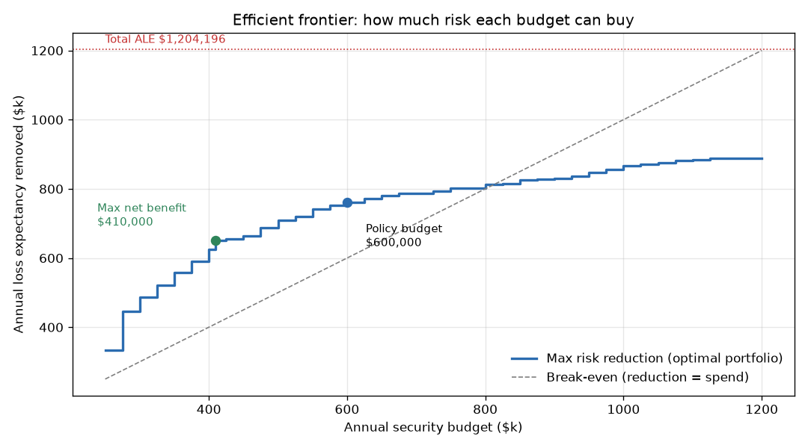
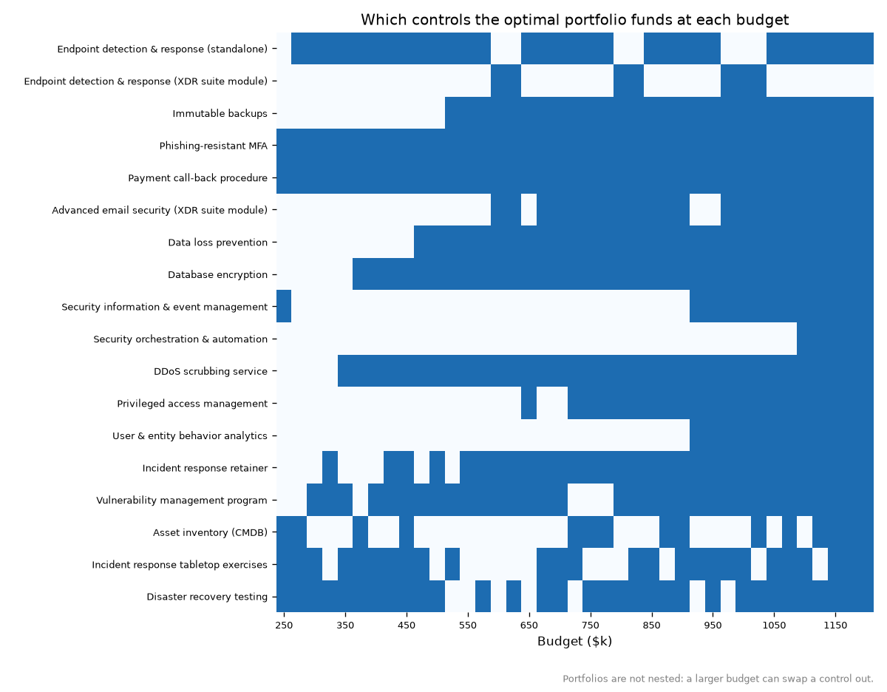

# Results

Generated by `python run_all.py`. All inputs are **illustrative** (see `data/README.md`); scenario ALEs come from the companion [cyber-risk-monte-carlo](https://github.com/casildata/cyber-risk-monte-carlo) simulation.

## 1. Inputs

**Risk scenarios** (total ALE $1,204,196):

| id | scenario | ALE |
|---|---|---|
| RANSOM | Ransomware | $337,719 |
| BEC | Business email compromise | $239,333 |
| BREACH | Customer data breach | $380,614 |
| DDOS | DDoS outage | $132,075 |
| INSIDER | Insider misuse | $114,455 |

**Control catalogue:**

| control_id | name | csf_function | annual_cost | analyst_hours | platform | exclusive_group | requires |
|---|---|---|---|---|---|---|---|
| EDR_A | Endpoint detection & response (standalone) | Detect | $150,000 | 300 |  | edr |  |
| EDR_B | Endpoint detection & response (XDR suite module) | Detect | $110,000 | 350 | xdr_suite | edr |  |
| IMM_BACKUP | Immutable backups | Recover | $70,000 | 150 |  |  |  |
| MFA_PR | Phishing-resistant MFA | Protect | $45,000 | 120 |  |  |  |
| PAY_CALLBACK | Payment call-back procedure | Protect | $15,000 | 200 |  |  |  |
| EMAIL_SEC | Advanced email security (XDR suite module) | Protect | $55,000 | 100 | xdr_suite |  |  |
| DLP | Data loss prevention | Protect | $90,000 | 400 |  |  |  |
| DB_ENC | Database encryption | Protect | $40,000 | 120 |  |  |  |
| SIEM | Security information & event management | Detect | $120,000 | 800 |  |  |  |
| SOAR | Security orchestration & automation | Respond | $60,000 | -300 |  |  | SIEM |
| DDOS_SCRUB | DDoS scrubbing service | Protect | $50,000 | 40 |  |  |  |
| PAM | Privileged access management | Protect | $85,000 | 250 |  |  |  |
| UEBA | User & entity behavior analytics | Detect | $70,000 | 300 |  |  | SIEM |
| IR_RETAINER | Incident response retainer | Respond | $35,000 | 20 |  |  |  |
| VULN_MGMT | Vulnerability management program | Identify | $50,000 | 350 |  |  |  |
| ASSET_INV | Asset inventory (CMDB) | Identify | $30,000 | 150 |  |  |  |
| TABLETOP | Incident response tabletop exercises | Respond | $10,000 | 80 |  |  |  |
| DR_TEST | Disaster recovery testing | Recover | $25,000 | 120 |  |  |  |

## 2. Recommended portfolio at a $600,000 budget

| control_id | name | csf_function | annual_cost | analyst_hours |
|---|---|---|---|---|
| EDR_B | Endpoint detection & response (XDR suite module) | Detect | $110,000 | 350 |
| IMM_BACKUP | Immutable backups | Recover | $70,000 | 150 |
| MFA_PR | Phishing-resistant MFA | Protect | $45,000 | 120 |
| PAY_CALLBACK | Payment call-back procedure | Protect | $15,000 | 200 |
| EMAIL_SEC | Advanced email security (XDR suite module) | Protect | $55,000 | 100 |
| DLP | Data loss prevention | Protect | $90,000 | 400 |
| DB_ENC | Database encryption | Protect | $40,000 | 120 |
| DDOS_SCRUB | DDoS scrubbing service | Protect | $50,000 | 40 |
| IR_RETAINER | Incident response retainer | Respond | $35,000 | 20 |
| VULN_MGMT | Vulnerability management program | Identify | $50,000 | 350 |

- Spend: **$600,000** (includes XDR suite platform fee $40,000)
- Risk reduction: **$760,305** of $1,204,196 (63%); residual ALE $443,891
- Net benefit $160,305 · ROSI +27%
- Analyst hours 1,850 of 2,000 (in-house team)

| scenario | ale_before | ale_after | reduction | share_removed |
|---|---|---|---|---|
| Ransomware | $337,719 | $86,373 | $251,346 | 74% |
| Business email compromise | $239,333 | $70,005 | $169,328 | 71% |
| Customer data breach | $380,614 | $153,086 | $227,528 | 60% |
| DDoS outage | $132,075 | $50,188 | $81,886 | 62% |
| Insider misuse | $114,455 | $84,239 | $30,216 | 26% |

**Verification.** Exhaustive enumeration of all 262,144 control subsets (0.1 s) gives the same optimum, $760,305. MILP solve time 185 ms. PuLP cross-check skipped (PuLP not installed).

## 3. Budget sweep

The cheapest portfolio that satisfies every policy rule costs **$230,000**; below that the problem is infeasible.

| budget | spend | risk_reduction | share_of_ALE | net_benefit | controls | MSSP |
|---|---|---|---|---|---|---|
| $300,000 | $295,000 | $486,396 | 40% | $191,396 | 6 | no |
| $400,000 | $385,000 | $625,542 | 52% | $240,542 | 8 | no |
| $500,000 | $500,000 | $709,006 | 59% | $209,006 | 9 | no |
| $600,000 | $600,000 | $760,305 | 63% | $160,305 | 10 | no |
| $700,000 | $675,000 | $786,200 | 65% | $111,200 | 12 | no |
| $800,000 | $800,000 | $812,336 | 67% | $12,336 | 12 | yes |
| $1,000,000 | $1,000,000 | $867,003 | 72% | -$132,997 | 15 | yes |
| $1,200,000 | $1,130,000 | $889,277 | 74% | -$240,723 | 17 | yes |

Net benefit (risk removed minus spend) peaks at **$410,000** of spend ($240,965), found directly by the `max_net_benefit` objective (the sweep's best grid point is $400,000). Beyond that, each extra dollar buys less than a dollar of risk reduction. Spending more can still be right if leadership's risk appetite demands a lower residual ALE, but it's a risk decision, not an ROI one.

## 4. Sensitivity

**Constraint slack at the recommended portfolio:**

| constraint | limit | used | slack |
|---|---|---|---|
| Budget | $600,000 | $600,000 | $0 |
| Analyst hours | 2,000 | 1,850 | 150 |
| Coverage: Identify | >= 1 | 1 | 0 |
| Coverage: Protect | >= 1 | 6 | 5 |
| Coverage: Detect | >= 1 | 1 | 0 |
| Coverage: Respond | >= 1 | 1 | 0 |
| Coverage: Recover | >= 1 | 1 | 0 |

**Marginal value of budget.** Going from $575,000 to $600,000 bought 0.31 dollars of risk reduction per extra dollar (from the sweep). The LP relaxation's shadow price on the budget is 0.51; for a 0/1 problem that dual is only indicative, which is why the sweep is the number to quote.

**Price of each policy rule:** extra risk reduction gained by re-optimizing with the rule removed. For the MSSP row the option is taken away, so a negative number is what having the option is worth.

| policy rule | at $300,000 | at $400,000 | at $600,000 | at $1,000,000 |
|---|---|---|---|---|
| Mandatory phishing-resistant MFA | $0 | $0 | $0 | $0 |
| At least one control per CSF function | $76,424 | $16,728 | $0 | $0 |
| Protect <= 2 x (Detect + Respond + Recover) | $0 | $0 | $0 | $0 |
| MSSP option available | $0 | $0 | $0 | -$64,736 |

$0 means relaxing the rule buys nothing at that budget. A rule can be tight (zero slack) and still cost nothing, when another portfolio of equal value exists.

## 5. Minimum spend to reach a risk-reduction target

| target | min_spend | achieved | controls |
|---|---|---|---|
| 40% of ALE | $295,000 | 40.4% | 6 |
| 50% of ALE | $385,000 | 51.9% | 8 |
| 60% of ALE | $540,000 | 60.7% | 9 |
| 70% of ALE | $935,000 | 70.2% | 13 |

## 6. Model size

96 variables (20 binary), 167 constraints. LP relaxation bound $863,182 vs. integer optimum $760,305 (gap 13.5%).
