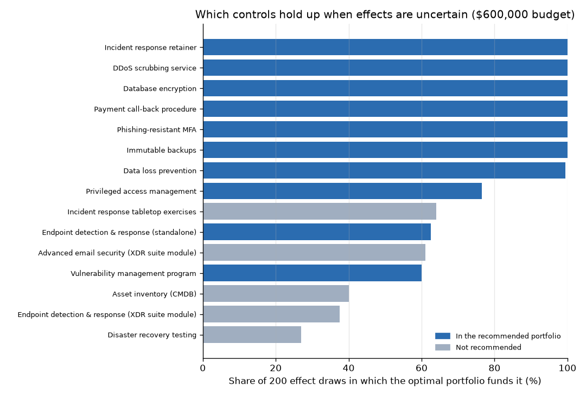

# Results

Generated by `python run_all.py`. All inputs are **illustrative** (see `data/README.md`); scenario ALEs are the mean simulated annual losses from the companion [cyber-risk-monte-carlo](https://github.com/casildata/cyber-risk-monte-carlo) project, read from the cyber-risk-monte-carlo v1.0 release (SHA-256 checked).

## 1. Inputs

**Risk scenarios** (total ALE $1,204,196):

| id | scenario | ALE |
|---|---|---|
| RANSOM | Ransomware | $337,719 |
| BEC | Business email compromise | $239,333 |
| BREACH | Customer data breach | $380,614 |
| DDOS | DDoS outage | $132,075 |
| INSIDER | Insider misuse | $114,455 |

**Control catalogue:**

| control_id | name | csf_function | cis_safeguard | annual_cost | analyst_hours | platform | exclusive_group | requires |
|---|---|---|---|---|---|---|---|---|
| EDR_A | Endpoint detection & response (standalone) | Detect | 10.1; 10.7; 13.7 | $100,000 | 300 |  | edr |  |
| EDR_B | Endpoint detection & response (XDR suite module) | Detect | 10.1; 10.7; 13.7 | $60,000 | 350 | xdr_suite | edr |  |
| IMM_BACKUP | Immutable backups | Recover | 11.4 | $50,000 | 150 |  |  |  |
| MFA_PR | Phishing-resistant MFA | Protect | 6.3; 6.5 | $45,000 | 120 |  |  |  |
| PAY_CALLBACK | Payment call-back procedure | Protect |  | $15,000 | 200 |  |  |  |
| EMAIL_SEC | Advanced email security (XDR suite module) | Protect | 9.7 | $55,000 | 100 | xdr_suite |  |  |
| DLP | Data loss prevention | Protect | 3.13 | $85,000 | 400 |  |  |  |
| DB_ENC | Database encryption | Protect | 3.11 | $35,000 | 120 |  |  |  |
| SIEM | Security information & event management | Detect | 8.11; 13.1 | $120,000 | 800 |  |  |  |
| SOAR | Security orchestration & automation | Respond |  | $60,000 | -300 |  |  | SIEM |
| DDOS_SCRUB | DDoS scrubbing service | Protect |  | $50,000 | 40 |  |  |  |
| PAM | Privileged access management | Protect | 5.4 | $85,000 | 250 |  |  |  |
| UEBA | User & entity behavior analytics | Detect |  | $70,000 | 300 |  |  | SIEM |
| IR_RETAINER | Incident response retainer | Respond | 17.4 | $35,000 | 20 |  |  |  |
| VULN_MGMT | Vulnerability management program | Identify | 7.1 | $50,000 | 350 |  |  |  |
| ASSET_INV | Asset inventory (CMDB) | Identify | 1.1 | $30,000 | 150 |  |  |  |
| TABLETOP | Incident response tabletop exercises | Respond | 17.7 | $10,000 | 80 |  |  |  |
| DR_TEST | Disaster recovery testing | Recover | 11.5 | $25,000 | 120 |  |  |  |

## 2. Recommended portfolio at a $600,000 budget

| control_id | name | csf_function | annual_cost | analyst_hours |
|---|---|---|---|---|
| EDR_A | Endpoint detection & response (standalone) | Detect | $100,000 | 300 |
| IMM_BACKUP | Immutable backups | Recover | $50,000 | 150 |
| MFA_PR | Phishing-resistant MFA | Protect | $45,000 | 120 |
| PAY_CALLBACK | Payment call-back procedure | Protect | $15,000 | 200 |
| DLP | Data loss prevention | Protect | $85,000 | 400 |
| DB_ENC | Database encryption | Protect | $35,000 | 120 |
| DDOS_SCRUB | DDoS scrubbing service | Protect | $50,000 | 40 |
| PAM | Privileged access management | Protect | $85,000 | 250 |
| IR_RETAINER | Incident response retainer | Respond | $35,000 | 20 |
| VULN_MGMT | Vulnerability management program | Identify | $50,000 | 350 |

- Spend: **$550,000**
- Risk reduction: **$867,008** of $1,204,196 (72%); residual ALE $337,188
- Net benefit $317,008 · ROSI +58%
- Analyst hours 1,950 of 2,000 (in-house team)

| scenario | ale_before | ale_after | reduction | share_removed |
|---|---|---|---|---|
| Ransomware | $337,719 | $55,367 | $282,352 | 84% |
| Business email compromise | $239,333 | $64,620 | $174,713 | 73% |
| Customer data breach | $380,614 | $101,087 | $279,527 | 73% |
| DDoS outage | $132,075 | $50,188 | $81,886 | 62% |
| Insider misuse | $114,455 | $65,926 | $48,529 | 42% |

**Verification.** Exhaustive enumeration of all 262,144 control subsets gives the same optimum, $867,008. PuLP/CBC on the same model: $867,008 (matches).

## 3. Budget sweep

The cheapest portfolio that satisfies every policy rule costs **$210,000**; below that the problem is infeasible.

| budget | spend | risk_reduction | share_of_ALE | net_benefit | controls | MSSP |
|---|---|---|---|---|---|---|
| $300,000 | $285,000 | $653,567 | 54% | $368,567 | 7 | no |
| $400,000 | $390,000 | $776,946 | 65% | $386,946 | 9 | no |
| $500,000 | $500,000 | $844,780 | 70% | $344,780 | 11 | no |
| $600,000 | $550,000 | $867,008 | 72% | $317,008 | 10 | no |
| $700,000 | $650,000 | $882,677 | 73% | $232,677 | 12 | no |
| $800,000 | $800,000 | $903,446 | 75% | $103,446 | 14 | yes |
| $1,000,000 | $990,000 | $945,610 | 79% | -$44,390 | 16 | yes |
| $1,200,000 | $1,050,000 | $951,631 | 79% | -$98,369 | 17 | yes |

Net benefit (risk removed minus spend) peaks at **$355,000** of spend ($401,093), found directly by the `max_net_benefit` objective and confirmed by exhaustive search (the sweep's best grid point is $375,000). Beyond that, each extra dollar buys less than a dollar of risk reduction. Spending more can still be right if leadership's risk appetite demands a lower residual ALE, but it's a risk decision, not an ROI one.

## 4. Baseline: buying controls by bang for the buck

Greedy rule: start from the mandated controls, then keep adding the control with the most risk reduction per extra dollar (platform and MSSP fees included) that still fits the budget, product conflicts, prerequisites and analyst hours. It has no way to plan for the coverage or ratio rules, so the table reports the rules it breaks.

| budget | greedy_spend | greedy_reduction | optimal_reduction | optimal_minus_greedy | rules_greedy_breaks |
|---|---|---|---|---|---|
| $300,000 | $295,000 | $722,771 | $653,567 | -$69,205 | Identify coverage, Respond coverage |
| $400,000 | $390,000 | $791,898 | $776,946 | -$14,951 | Identify coverage |
| $500,000 | $500,000 | $844,780 | $844,780 | $0 | none |
| $600,000 | $550,000 | $867,008 | $867,008 | $0 | none |
| $700,000 | $675,000 | $877,984 | $882,677 | $4,694 | none |
| $800,000 | $800,000 | $903,446 | $903,446 | $0 | none |
| $900,000 | $800,000 | $903,446 | $925,739 | $22,293 | none |
| $1,000,000 | $990,000 | $945,610 | $945,610 | $0 | none |

Where greedy beats the optimizer, it does so by skipping a required CSF function. Where it follows the rules, it can still leave risk reduction on the table, because the best portfolio at a larger budget isn't the smaller one plus extras.

## 5. Robustness to uncertain control effects

Each effect is drawn from its triangular range in `control_effects.csv` (`reduction_min`, `reduction`, `reduction_max`), 200 times (seed 2026), and the $600,000 portfolio is re-optimized for every draw. **Regret** is the risk reduction the recommended portfolio gives up against that draw's best one.

- The recommended portfolio is exactly optimal in **35%** of draws.
- Regret: mean **$5,735**, 95th percentile $20,495, worst $36,780, against $867,008 of risk removed at the nominal effects.
- Chosen in every draw: Immutable backups, Phishing-resistant MFA, Payment call-back procedure, Database encryption, DDoS scrubbing service, Incident response retainer.

| control | recommended | draws_chosen (of 200) |
|---|---|---|
| Incident response retainer | yes | 200 |
| DDoS scrubbing service | yes | 200 |
| Database encryption | yes | 200 |
| Payment call-back procedure | yes | 200 |
| Phishing-resistant MFA | yes | 200 |
| Immutable backups | yes | 200 |
| Data loss prevention | yes | 199 |
| Privileged access management | yes | 153 |
| Incident response tabletop exercises |  | 128 |
| Endpoint detection & response (standalone) | yes | 125 |
| Advanced email security (XDR suite module) |  | 122 |
| Vulnerability management program | yes | 120 |
| Asset inventory (CMDB) |  | 80 |
| Endpoint detection & response (XDR suite module) |  | 75 |
| Disaster recovery testing |  | 54 |

## 6. Sensitivity

**Constraint slack at the recommended portfolio:**

| constraint | limit | used | slack |
|---|---|---|---|
| Budget | $600,000 | $550,000 | $50,000 |
| Analyst hours | 2,000 | 1,950 | 50 |
| Coverage: Identify | >= 1 | 1 | 0 |
| Coverage: Protect | >= 1 | 6 | 5 |
| Coverage: Detect | >= 1 | 1 | 0 |
| Coverage: Respond | >= 1 | 1 | 0 |
| Coverage: Recover | >= 1 | 1 | 0 |

**Marginal value of budget.** Going from $575,000 to $600,000 bought 0.00 dollars of risk reduction per extra dollar (from the sweep). The LP relaxation's shadow price on the budget is 0.16; for a 0/1 problem that dual is only indicative, which is why the sweep is the number to quote.

**Price of each policy rule:** extra risk reduction gained by re-optimizing with the rule removed. For the MSSP row the option is taken away, so a negative number is what having the option is worth.

| policy rule | at $300,000 | at $400,000 | at $600,000 | at $1,000,000 |
|---|---|---|---|---|
| Mandatory phishing-resistant MFA | $8,285 | $0 | $0 | $0 |
| At least one control per CSF function | $69,205 | $14,951 | $3,153 | $0 |
| Protect <= 2 x (Detect + Respond + Recover) | $0 | $0 | $0 | $0 |
| MSSP option available | $0 | $0 | $0 | -$62,933 |

$0 means relaxing the rule buys nothing at that budget. A rule can be tight (zero slack) and still cost nothing, when another portfolio of equal value exists.

## 7. Minimum spend to reach a risk-reduction target

| target | min_spend | achieved | controls |
|---|---|---|---|
| 40% of ALE | $225,000 | 40.5% | 6 |
| 50% of ALE | $260,000 | 50.4% | 7 |
| 60% of ALE | $335,000 | 60.9% | 8 |
| 70% of ALE | $490,000 | 70.0% | 10 |

Exhaustive search finds the same minimum spend for every target.

## 8. Model size

96 variables (20 binary), 167 constraints. LP relaxation bound $950,742 vs. integer optimum $867,008 (gap 9.7%).
